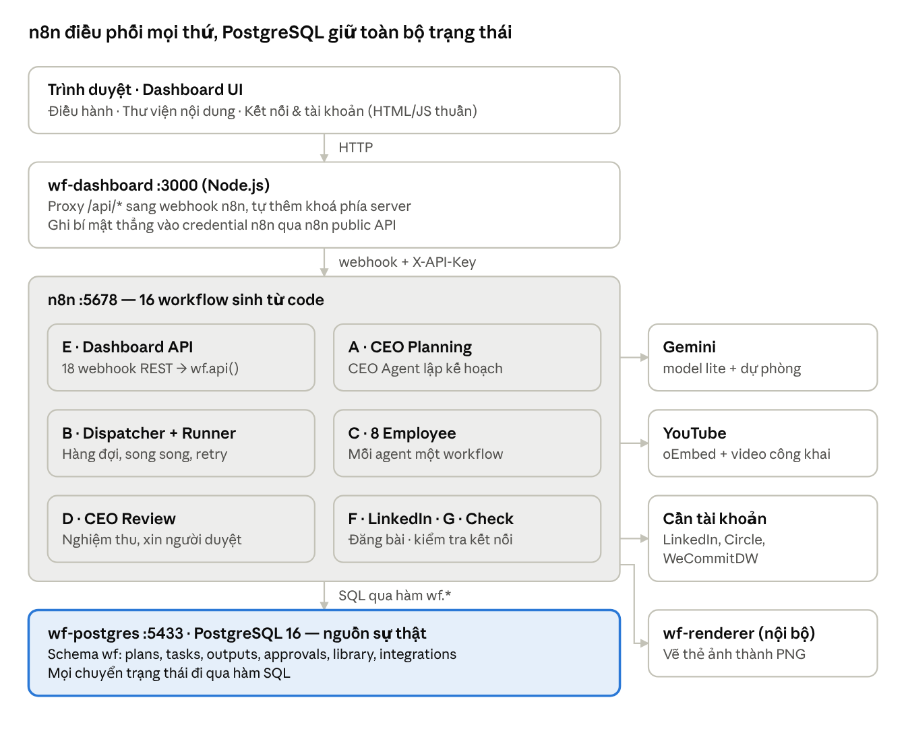
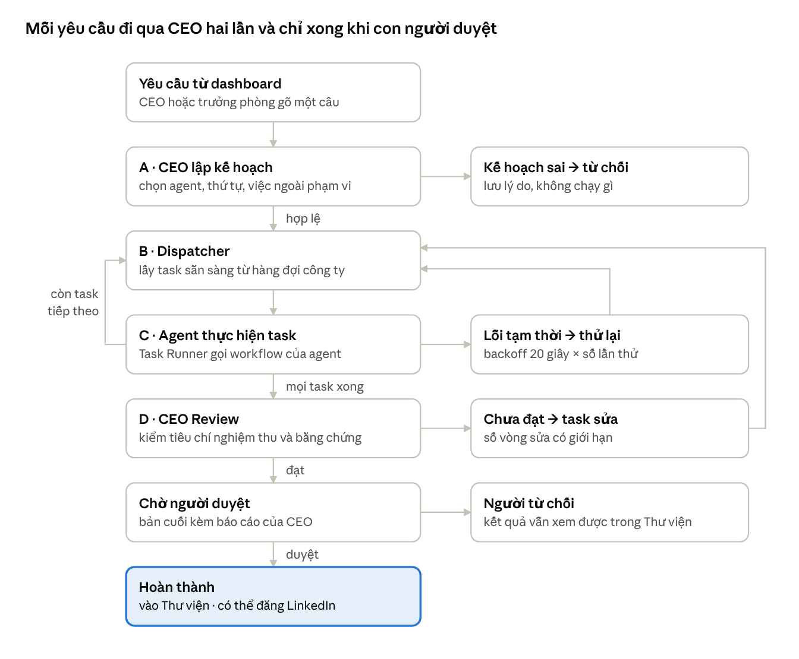

# Báo cáo dự án AI Workforce (n8n)

16/10/2026

AI Workforce là một "công ty ảo" chạy local trên Docker: CEO AI nhận yêu cầu, lập kế hoạch, giao việc cho 8 nhân sự AI thuộc 3 phòng ban, tự review kết quả rồi chờ con người duyệt. Toàn bộ chạy trên n8n + PostgreSQL + Gemini, điều khiển qua một dashboard web.

## 1. Tổng quan

Hệ thống biến một câu yêu cầu bằng tiếng Việt thành một kế hoạch nhiều bước, chạy song song trên các agent chuyên môn, và trả về sản phẩm đã qua CEO review và con người duyệt. Mọi trạng thái nằm trong PostgreSQL, nên hệ thống chịu được restart, F5 và lỗi giữa chừng.

**Ví dụ đã chạy thật:** "Xem video YouTube này, viết bài LinkedIn cho quản lý không chuyên kỹ thuật, chuyển thành kịch bản video ngắn và làm ảnh minh hoạ". CEO chia thành 3 việc: YouTube-to-LinkedIn chạy trước, Repurpose Studio và Visual Design chạy song song sau đó. Tổng thời gian khoảng 5 phút, có một lần retry tự động.

**Khả năng chính**

- CEO AI lập kế hoạch: tự chọn agent, đặt phụ thuộc giữa các việc, từ chối việc ngoài khả năng (`out_of_scope`).
- Chạy song song, retry có backoff, chống chạy trùng, hàng đợi toàn công ty (mỗi agent làm 1 việc một lúc, việc CEO được ưu tiên).
- CEO review theo tiêu chí nghiệm thu, có vòng sửa giới hạn; bản cuối luôn chờ con người duyệt.
- 3 phòng ban giao việc độc lập; mỗi phòng chỉ giao được cho agent của mình (chặn ở DB).
- Thư viện nội dung theo phòng ban, đăng LinkedIn sau khi duyệt, trang nhập tài khoản các dịch vụ ngoài.

**Công nghệ**

| Lớp | Công nghệ |
| --- | --- |
| Điều phối, AI agent | n8n 2.42.6 (SQLite nội bộ), node AI Agent + Gemini |
| Mô hình AI | `gemini-3.5-flash-lite`, dự phòng `gemini-3.1-flash-lite` (gói miễn phí) |
| Dữ liệu nghiệp vụ | PostgreSQL 16, schema `wf` |
| Frontend | Node.js 22 (server không thư viện) + HTML/CSS/JS thuần |
| Vẽ ảnh | Service riêng: rough.js + resvg, font Patrick Hand / Be Vietnam Pro |
| Hạ tầng | Docker Compose, chạy local trên Windows (WSL2) |

**Quy mô codebase** (không tính file sinh tự động)

| Thư mục | Vai trò | File | Dòng |
| --- | --- | --- | --- |
| `workflows/` | Nguồn sinh 16 workflow n8n + 8 agent | 22 | 2.314 |
| `db/` | Schema, hàm SQL, test DB | 12 | 1.941 |
| `dashboard/` | Server + giao diện web | 7 | 1.908 |
| `tests/` | Test code-node, smoke, kịch bản CEO | 8 | 373 |
| `renderer/` | Service vẽ ảnh | 3 | 217 |
| `scripts/` | Deploy, credential, tiện ích API | 4 | 151 |

## 2. Kiến trúc

Trình duyệt chỉ nói chuyện với `wf-dashboard`; dashboard gọi webhook của n8n, n8n gọi Gemini và các dịch vụ ngoài, và mọi thay đổi trạng thái đều ghi vào PostgreSQL qua hàm SQL. Bốn container chạy trên Docker Compose, chỉ mở cổng trên 127.0.0.1.

## 3. Luồng xử lý một yêu cầu

Dispatcher được đánh thức sau mỗi task, nên việc phụ thuộc chạy ngay khi điều kiện đủ và việc độc lập chạy song song; một lịch mỗi phút dọn các lần đánh thức bị lỡ và execution bị kẹt. CEO không bao giờ tự đánh dấu hoàn thành: chỉ con người duyệt mới chuyển kế hoạch sang `completed`.

## 4. Backend 1 — Database (PostgreSQL, schema `wf`)

PostgreSQL là nguồn sự thật duy nhất: mọi chuyển trạng thái đi qua hàm SQL, n8n chỉ gọi hàm chứ không tự sửa bảng. Dashboard đi qua một cửa duy nhất `wf.api(action, args)`, hàm này trả lỗi dưới dạng dữ liệu (400 / 404 / 409) vì node Postgres của n8n làm mất nội dung lỗi DB.

| Bảng | Lưu gì |
| --- | --- |
| `departments`, `employees`, `employee_skills` | 3 phòng ban, 8 agent, skill của từng agent; `max_concurrent` (mặc định 1) |
| `plans` | Mỗi yêu cầu: mục tiêu, context, phòng ban gửi, trạng thái |
| `tasks`, `task_dependencies` | Các bước của kế hoạch và phụ thuộc giữa chúng |
| `task_executions`, `task_outputs` | Từng lần chạy (retry) và kết quả JSON của agent |
| `approvals` | Yêu cầu duyệt của con người |
| `execution_events` | Nhật ký sự kiện (audit) |
| `knowledge_articles` | Kho tri thức đã duyệt, tìm full-text (đang trống) |
| `publications` | Bài LinkedIn đã/đang đăng, bản chụp chữ + ảnh lúc đăng |
| `library_items` | Trạng thái quản lý nội dung: mới / đã dùng / lưu trữ |
| `integration_settings` | Cấu hình không bí mật của LinkedIn, Circle, WeCommitDW + lần test cuối |

**Trạng thái kế hoạch:** `planning → running → reviewing → awaiting_approval → completed | rejected`, cộng `blocked`, `failed`, `cancelled`. **Trạng thái task:** `pending, ready, running, completed, failed, blocked, cancelled, awaiting_approval`; một trigger từ chối mọi chuyển trạng thái không hợp lệ.

**Các bảo đảm quan trọng**

- **Không chạy trùng:** khoá dòng plan, điều kiện `status = 'ready'` khi cập nhật, và unique index chỉ cho 1 execution `running` mỗi task.
- **Hàng đợi công ty** (`wf.claim_next_tasks`, advisory lock): việc CEO trước việc phòng ban, rồi theo độ ưu tiên, rồi ai đến trước; không ngắt việc đang chạy; tối đa 3 task chạy cùng lúc mỗi kế hoạch.
- **Retry:** lỗi có thể thử lại được xếp lại với backoff 20 giây × số lần thử; execution kẹt quá 15 phút bị đánh timeout.
- **Phòng ban:** `wf.insert_tasks` từ chối mọi task giao cho agent ngoài phòng ban gửi yêu cầu, kể cả task sửa do CEO review tạo.
- **Đang lập kế hoạch là một trạng thái được lưu**, nên mọi tab và sau F5 đều thấy CEO đang bận; mỗi phạm vi chỉ lập 1 kế hoạch một lúc.

Các file SQL áp theo thứ tự: `schema.sql → planning.sql → queue.sql → dashboard-functions.sql → publishing.sql → library.sql → integrations.sql → generated/seed-organization.sql`. Tất cả đều idempotent (chạy lại không hỏng dữ liệu).

## 5. Backend 2 — Workflow n8n

Có 16 workflow, tất cả được **sinh từ code** (`workflows/src` → `node workflows/build-workflows.js` → `workflows/dist/*.json`) với ID cố định, rồi import bằng n8n CLI. Không sửa workflow trong giao diện n8n: lần deploy sau sẽ ghi đè. Cách này giúp workflow có version, review được và test được logic các node Code.

| Workflow | ID | Vai trò | Kích hoạt bởi |
| --- | --- | --- | --- |
| A · CEO Planning | `wfaCeoPlanning01` | Kiểm tra yêu cầu → nạp danh mục nhân sự → CEO Agent lập kế hoạch (structured output) → kiểm tra ID, agent, phụ thuộc, vòng lặp → lưu → trả 202 | Webhook `POST requests` |
| B · Task Dispatcher | `wfbDispatcher001` | Đánh giá phụ thuộc, nhận việc sẵn sàng từ hàng đợi, khởi động từng task kiểu fire-and-forget (song song thật) | Planning, mỗi task xong, lịch mỗi phút |
| B · Task Runner | `wfbTaskRunner001` | Chạy 1 task: gọi workflow của agent, ghi kết quả hoặc lỗi (retry trong DB), đánh thức dispatcher | Dispatcher |
| C · 8 Employee | `wfcEmp…` | Mỗi agent một workflow riêng: kiểm tra đầu vào → công cụ → prompt → AI Agent → hậu kiểm | Task Runner |
| D · CEO Review | `wfdCeoReview0001` | Kiểm tiêu chí nghiệm thu và bằng chứng; tạo task sửa (có giới hạn) hoặc viết báo cáo cuối và xin duyệt; không bao giờ tự đánh dấu hoàn thành | Khi mọi task xong |
| E · Dashboard API | `wfeDashboardApi1` | 18 webhook REST, mỗi cái gọi `wf.api(...)`; wake dispatcher sau retry/duyệt | Dashboard |
| F · LinkedIn Publisher | `wffLinkedInPub01` | Đăng đúng bản chụp chữ + ảnh đã duyệt lên trang cá nhân, ghi URN/URL hoặc lỗi | Dashboard API |
| G · Integration Check | `wfgIntegrations1` | Một lệnh gọi thật, chỉ đọc, để kiểm tra tài khoản LinkedIn / Circle / WeCommitDW | Dashboard |
| 0 · Architecture Overview | `wf0Architecture1` | Bản đồ toàn hệ thống trên một canvas, link tới từng workflow; không chạy | — |

**Hợp đồng chung của mọi agent:** nhận một payload chuẩn (kế hoạch, task, đầu vào, kết quả của bước trước) và trả về `{ status: 'completed', output }` hoặc `{ status: 'failed', error: { code, message, retryable } }`. Mỗi AI Agent có model chính + model dự phòng + output parser có schema, retry 3 lần ở mức node.

**Những điều n8n bắt phải làm khác đi** (đã kiểm chứng):

- Webhook có tham số trong đường dẫn cần tiền tố webhook-id, nên API dùng đường dẫn tĩnh + query string.
- Node Postgres không đi vào nhánh lỗi khi mất kết nối DB mà đẩy item đi tiếp không có kết quả; các bước sau tự kiểm tra và trả 503 có giải thích.
- Lệnh `publish:workflow` đôi khi lỗi do khoá SQLite tạm thời, nên deploy retry 3 lần và restart n8n.

## 6. Đội ngũ 8 agent

Mỗi agent là một module riêng trong `workflows/src/employees/` (skill, schema đầu vào/ra, prompt, kiểm tra đầu vào, hậu kiểm). Nguyên tắc chung: **không bịa**. Agent phân tích dữ liệu chỉ dùng dữ liệu được cung cấp, và hậu kiểm loại bỏ phần không có trong nguồn.

| Agent | Phòng | Làm gì | Đầu vào | Kiểm soát chống bịa / giới hạn |
| --- | --- | --- | --- | --- |
| YouTube-to-LinkedIn | Marketing | Xem video YouTube công khai, viết bài LinkedIn ≤ 3.000 ký tự | Link YouTube hoặc transcript | oEmbed lấy tiêu đề thật; tự gỡ Markdown; video riêng tư không đọc được |
| Repurpose Studio | Marketing | Chuyển một nguồn thành nhiều định dạng: kịch bản video ngắn, tóm tắt, outline, bài LinkedIn | Nội dung nguồn hoặc kết quả bước trước | Giữ thông điệp chính thống nhất giữa các bản |
| Visual Design | Marketing | Viết spec thẻ ảnh, renderer vẽ PNG phong cách phác tay | Bài viết hoặc ý tưởng | Chỉ lấy ý và số từ nguồn; không dùng AI tạo ảnh (quota miễn phí = 0) |
| WeCommitDW System Checker | Vận hành | Tìm lỗi, rủi ro, đề xuất từ log / báo cáo hệ thống | Dữ liệu dán vào | Mỗi phát hiện kèm trích dẫn, đối chiếu lại (`evidence_verified`) |
| Skill Recommendation | Vận hành | Đề xuất agent và skill phù hợp cho một việc, kèm các bước | Mô tả việc | Chỉ chọn trong danh mục DB; agent/skill không có thật bị loại |
| Circle Community Checker | CSKH & Cộng đồng | Phân loại thread, soạn trả lời nháp, chỉ ra việc cần chuyển người | Thread dán vào | Trả lời chỉ là nháp, không tự đăng; chưa đọc Circle trực tiếp |
| Coaching Timeline | CSKH & Cộng đồng | Chia chương, chọn highlight, ghi chú cho người dựng | Transcript có mốc giờ | Loại mọi mốc giờ không có trong transcript |
| Knowledge & Support | CSKH & Cộng đồng | Trả lời câu hỏi từ tài liệu đã duyệt, trích nguồn | Câu hỏi | Không có nguồn thì chuyển người xử lý; kho tri thức đang trống |

Dữ liệu dán thẳng trong câu yêu cầu gửi CEO cũng tới được agent: 5 kịch bản demo (WeCommitDW, Skill, Circle, Coaching, Knowledge) đều được CEO giao đúng agent và chạy xong.

## 7. Frontend — Dashboard

Dashboard chạy tại `http://localhost:3000`, không dùng framework và không có bước build: một server Node nhỏ và HTML/CSS/JS thuần. Server giữ API key phía máy chủ, nên trình duyệt không bao giờ thấy key.

**Phía server**

| File | Vai trò |
| --- | --- |
| `dashboard/server.js` | Phục vụ giao diện và ảnh `/assets/*`; proxy `/api/*` sang webhook n8n theo danh sách cho phép, tự thêm header `X-API-Key` |
| `dashboard/integrations.js` | Xử lý trang Kết nối: ghi bí mật thẳng vào credential n8n qua n8n public API, giữ n8n API key phía server |

**Phía trình duyệt**

| File | Vai trò |
| --- | --- |
| `public/app.js` | Điều hướng theo hash, polling 4 giây, thẻ agent, kế hoạch, duyệt, thư viện |
| `public/content-views.js` | Hiển thị dễ đọc cho 8 loại kết quả agent + xuất Markdown |
| `public/settings.js` | Trang "Kết nối & tài khoản" |
| `public/index.html`, `styles.css` | Bố cục, giao diện tối, responsive |

**Các màn hình**

- **Sidebar phạm vi:** Tổng quan · CEO (toàn công ty) và mỗi phòng ban một tab (`#dept_…`). Phạm vi quyết định yêu cầu được giao cho ai và dữ liệu nào được hiển thị.
- **Điều hành:** ô giao việc (kèm tài liệu đính kèm theo loại), banner "CEO đang lập kế hoạch" giữ được qua F5, kết quả gần đây, khu chờ duyệt, dải tiến độ kế hoạch (nút Dừng), thẻ từng agent (đồng hồ "đang suy luận", hàng chờ, lỗi + Thử lại, ô "Giao lại" giao thẳng không qua CEO).
- **Thư viện nội dung** (`#<phạm vi>/library`): mọi kết quả agent theo phòng ban; lọc theo trạng thái, agent, trạng thái duyệt, tìm kiếm; đánh dấu Mới → Đã dùng → Lưu trữ; xem dạng dễ đọc, sao chép, tải `.md`, tải ảnh.
- **Kết quả kế hoạch:** các bước, báo cáo của CEO, duyệt/từ chối, khung xem trước bài LinkedIn (đúng chữ và ảnh sẽ đăng), nút Đăng lên LinkedIn.
- **Kết nối & tài khoản** (`#settings`): thẻ n8n API key, LinkedIn, Circle, WeCommitDW; mỗi thẻ có hướng dẫn từng bước, nút Lưu và Kiểm tra kết nối.

## 8. Tích hợp bên ngoài

Gemini, YouTube và vẽ ảnh đang chạy thật; LinkedIn, Circle và WeCommitDW đã có đường đi, chờ tài khoản của người dùng.

| Dịch vụ | Trạng thái | Cách làm |
| --- | --- | --- |
| Gemini | Chạy thật (gói miễn phí) | Model lite làm chính vì Flash chỉ ~20 request/ngày, Pro trả 429, model tạo ảnh quota 0 |
| YouTube | Chạy thật | oEmbed lấy tiêu đề/kênh; Gemini xem video công khai và trả transcript có mốc giờ; link trong câu lệnh tự đưa vào context |
| Vẽ ảnh (`wf-renderer`) | Chạy thật | Service nội bộ vẽ thẻ phác tay thành PNG vào `data/assets`; Pollinations đã thử và bỏ (ảnh lạc đề, có watermark) |
| LinkedIn | Đã build, chờ app + Connect | Đăng bài chỉ sau khi duyệt, mỗi kế hoạch một lần; có ảnh thì đăng dạng IMAGE; token hết hạn sau 60 ngày |
| Circle | Nhập token + kiểm tra đã có; agent chưa đọc Circle | Kiểm tra gọi Admin API v2 thật; không token thì Circle trả 401 "API token not found" (đã xác nhận) |
| WeCommitDW | Nhập kết nối + kiểm tra đã có; agent chưa truy vấn | PostgreSQL, MySQL, SQL Server (một câu SELECT) hoặc HTTP API (GET có Bearer token) |

Kết nối được nhập trên trang **Kết nối & tài khoản**. Sau khi kiểm tra thành công với tài khoản thật, bước tiếp theo là nối Circle Checker và WeCommitDW Checker sang tự đọc dữ liệu.

## 9. Bảo mật

Mọi bí mật của dịch vụ ngoài nằm trong kho credential đã mã hoá của n8n; hệ thống chỉ nghe trên `127.0.0.1`, nên chỉ người dùng máy này truy cập được.

| Bí mật | Lưu ở đâu | Ai thấy |
| --- | --- | --- |
| Gemini API key, mật khẩu Postgres, token LinkedIn/Circle/WeCommitDW | Credential n8n (mã hoá) | Không trả về trình duyệt; trang Kết nối chỉ ghi, không đọc lại |
| `WORKFORCE_API_KEY` (bảo vệ webhook), mật khẩu DB | `.env` (gitignore) | Server dashboard và n8n |
| n8n API key (cho trang Kết nối) | `data/dashboard/n8n-api-key` (quyền 600, gitignore) | Server dashboard |

- **Webhook có khoá:** mọi endpoint dùng Header Auth `X-API-Key`; dashboard proxy tự thêm key và chỉ cho đi qua danh sách endpoint cho phép.
- **Cấu hình không bí mật có danh sách trường cho phép:** `wf.save_integration_config` từ chối mọi trường lạ, nên mật khẩu lỡ gõ nhầm ô không thể lọt vào DB.
- **Chỉ đọc khi kiểm tra:** test kết nối chỉ gọi GET hoặc một SELECT; khuyến nghị dùng tài khoản chỉ đọc.
- **Không tự đăng ra ngoài:** LinkedIn chỉ đăng kế hoạch đã duyệt, có hộp xác nhận, chống đăng trùng; trả lời Circle và hỗ trợ chỉ là bản nháp.
- **Điểm còn yếu:** dashboard chưa có đăng nhập và phân quyền theo phòng ban; header request (kể cả `X-API-Key`) xuất hiện trong dữ liệu execution của workflow lập kế hoạch; Gemini key cũ từng bị dán vào chat và cần được thay.

## 10. Vận hành và deploy

Hệ thống chạy bằng `docker compose up -d` và cập nhật bằng một lệnh deploy; chạy local nên không tốn phí cloud.

| Container | Cổng | Vai trò |
| --- | --- | --- |
| `n8n` | 127.0.0.1:5678 | Workflow, AI agent, webhook |
| `wf-postgres` | 127.0.0.1:5433 | Database nghiệp vụ `workforce` |
| `wf-dashboard` | 127.0.0.1:3000 | Giao diện + proxy API |
| `wf-renderer` | chỉ mạng nội bộ (3100) | Vẽ ảnh PNG |

**Deploy** — `scripts/deploy-workforce.ps1 -ProjectId <id dự án n8n>` chạy 5 bước:

1. Sinh workflow từ code và file seed tổ chức.
2. Áp các file SQL theo thứ tự (copy vào container rồi `psql -f`, vì pipe qua PowerShell 5.1 làm hỏng tiếng Việt).
3. Tạo credential giữ chỗ cho tích hợp nếu còn thiếu (không bao giờ ghi đè credential đã nhập), rồi import workflow.
4. Publish từng workflow (retry 3 lần).
5. Restart n8n và chờ sẵn sàng.

**Yêu cầu máy:** Docker Desktop + Node.js. Máy hiện tại có 7,7 GB RAM; Docker từng không khởi động được khi ổ C còn 2,8 GB trống và RAM gần cạn. Nên giữ ổ C trống trên 10 GB và giới hạn RAM WSL trong `.wslconfig`.

## 11. Kiểm thử

Tất cả bộ test dưới đây đã pass (các lần chạy từ 12 đến 14/10/2026); test DB chạy trong transaction rồi rollback nên không để lại dữ liệu.

| Bộ test | Kiểm tra gì | Kết quả |
| --- | --- | --- |
| `db/tests/test-task-state.sql` | Phụ thuộc, retry, chặn, review, duyệt, vòng lặp, phòng ban, hàng đợi | 14 mục pass |
| `db/tests/test-concurrent-claim.sh` | 8 phiên tranh 6 task cùng lúc | 6 lượt nhận, 0 trùng |
| `db/tests/test-concurrent-capacity.sh` | Agent sức chứa 1 bị 8 phiên tranh | Đúng 1 task chạy |
| `db/tests/test-library.sql` | Thư viện: lọc phòng ban, tìm kiếm, lưu trữ/khôi phục | Pass |
| `db/tests/test-integrations.sql` | Chỉ lưu trường cho phép, kiểm tra dữ liệu, kết quả test | Pass |
| `tests/code-nodes/run-code-node-tests.js` | Logic node Code: kiểm tra kế hoạch, vòng lặp, review | 20/20 pass |
| `tests/smoke-all-employees.js` | Cả 8 agent chạy thật trên Gemini | 8/8 completed |
| `tests/run-ceo-demo-scenarios.js` | 5 yêu cầu gửi CEO, dữ liệu dán trong câu lệnh | 5/5 giao đúng agent (sau khi sửa luật 12 cho CEO) |
| Thử tay trên trình duyệt | Thư viện, trang Kết nối, bấm vùng trống | Không lỗi JS |
| Tắt `wf-postgres` | API khi mất database | 503 có giải thích, tự hồi phục khi DB chạy lại |

## 12. Hạn chế và việc tiếp theo

Phần lõi đã chạy ổn; những việc còn lại chủ yếu chờ tài khoản, tài liệu hoặc quyết định của người dùng.

**Hạn chế hiện tại**

- Gemini gói miễn phí: phải dùng model lite, đôi khi lỗi 503 hoặc trả rỗng khi xem video (retry tự động đã bù được).
- Kho tri thức trống nên Knowledge & Support luôn chuyển người xử lý.
- Dashboard chưa có đăng nhập và phân quyền.
- Huỷ kế hoạch không dừng execution n8n đang chạy; kết quả của nó chỉ bị bỏ.
- Chưa sửa được nội dung trong thư viện (ví dụ chỉnh câu chữ bài LinkedIn trước khi đăng).

**Việc tiếp theo**

- [ ] Tạo n8n API key và nhập trên trang Kết nối & tài khoản
- [ ] Tạo app LinkedIn, bấm Connect, đăng thử một bài thật
- [ ] Nhập token Circle và kết nối WeCommitDW, rồi nối hai agent sang đọc dữ liệu thật
- [ ] Nạp tài liệu thật (chính sách hoàn tiền, FAQ) vào kho tri thức
- [ ] Thay Gemini API key đã bị lộ; cân nhắc bật billing để dùng model Flash/Pro
- [ ] Quyết định: phân vai YouTube-to-LinkedIn và Repurpose Studio (hai agent đang chồng chéo)
- [ ] Quyết định: có thêm bước duyệt kế hoạch trước khi chạy không
- [ ] Thêm đăng nhập và phân quyền theo phòng ban cho dashboard
